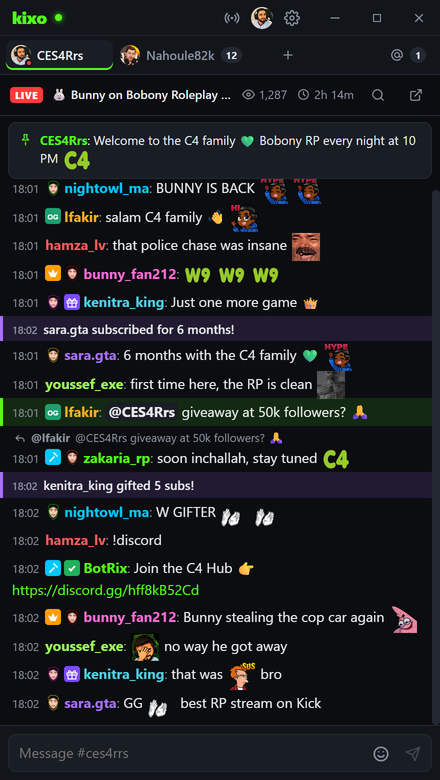

<p align="center">
  
</p>

<h1 align="center">Kixo</h1>

<p align="center">
  A fast, lightweight desktop chat client for <b>Kick</b>, built for chatters, mods and streamers.<br/>
  Free, open source, and built on Kick's official API.
</p>

<p align="center">
  <a href="https://github.com/achrafthedev/kixo/releases/latest"><b>⬇ Download for Windows</b></a> ·
  <a href="https://github.com/achrafthedev/kixo/releases/latest">macOS</a> ·
  <a href="https://github.com/achrafthedev/kixo/releases/latest">Linux</a>
</p>

<p align="center"></p>

<p align="center">
  Featured streamers: <a href="https://kick.com/ces4rrs"><b>CES4Rrs</b></a> · <a href="https://kick.com/nahoule82k"><b>Nahoule82k</b></a>
</p>

## Features

**Chat**
- Multiple channels in tabs: drag to reorder, unread counters, a live dot, middle-click to close
- Kick emotes, **7TV** channel and global emotes, real Kick badges (subscriber, mod, VIP, OG, founder, level…)
- Recent chat history loads as soon as you join a channel
- Replies, deleted-message tracking, bans and timeouts, subs, gift subs, hosts, KICKs, pinned messages, live polls
- `:emote` and `@user` autocomplete, Tab completion, a searchable emote picker with recently used emotes
- Smart auto-scroll: chat pauses when you scroll up and shows how many messages you've missed
- `Ctrl+F` search, with `@user` to filter by username

**Mentions & filters**
- Mentions tab that collects every @mention and highlight-word hit across all channels
- Sound and desktop notifications when you're tagged
- Ignore users, hide bots, add custom highlight words

**Moderation** (official Kick API)
- Hover a message to delete it, time out for 10 minutes, or open the user card
- User card: account age, follow date, sub months, recent messages, timeouts (1m–7d), ban and unban

**Streamer tools**
- **Stream manager**: change your stream title and category without opening kick.com
- **OBS chat overlay**: a transparent browser source with emotes and badges (`http://127.0.0.1:4848/overlay?channel=you`)
- Always-on-top and adjustable window opacity, so chat can sit on top of a game

**App**
- Dark, Midnight (OLED), Slate and Light themes, custom accent colour, font and emote size, compact mode
- Small and quick: about 300 kB of UI code, messages batched every 80 ms, one shared socket for all channels
- Automatic updates (installer build), single instance, remembers window position

## Download

Grab the latest build from **[Releases](https://github.com/achrafthedev/kixo/releases/latest)**:

| Platform | File |
| --- | --- |
| Windows (installer) | `Kixo-Setup-x.y.z.exe` (auto-updates) |
| Windows (portable) | `Kixo-Portable-x.y.z.exe` (no install) |
| macOS | `Kixo-x.y.z-arm64.dmg` / `-x64.dmg` |
| Linux | `Kixo-x.y.z.AppImage` / `.deb` |

> Builds aren't code-signed yet, so Windows SmartScreen may say "Windows protected your PC". Click **More info → Run anyway**.

## Logging in

You don't need an account to read chat. To send messages, moderate or edit your stream, log in with Kick (official OAuth 2.1 + PKCE).

Kick's token endpoint requires a client secret, and a secret can't be shipped safely inside a public app. Kixo supports two setups:

1. **Official builds** use a tiny token-exchange proxy ([`auth-proxy/`](auth-proxy)). It holds the secret and forwards only the two OAuth token calls. It never sees your chat and stores nothing.
2. **Bring your own Kick app.** In *Settings → Account → Use your own Kick app*, create an app at [kick.com/settings/developer](https://kick.com/settings/developer) with redirect URL `http://localhost:53682/callback`, then paste its Client ID and Secret. The secret is encrypted with your OS keychain.

## How it works

| Part | Source |
| --- | --- |
| Sending messages, replies, delete, ban/timeout/unban, stream title/category, your profile | **Official Kick Public API** (`api.kick.com/public/v1`) |
| Live chat stream | Kick's realtime service (Centrifugo, with Pusher fallback), the same public feed kick.com shows logged-out viewers |
| Chatroom ID, history, emote sets, user cards | Kick's public web endpoints (the official API doesn't expose these yet) |
| 7TV emotes | `7tv.io` API |

Kick doesn't offer a public read-chat API for desktop apps; the official Events API only delivers webhooks to public servers. When it does, Kixo will switch over.

## Development

```bash
git clone https://github.com/achrafthedev/kixo && cd kixo
npm install
npm run dev        # hot-reloading dev app
npm test           # unit tests
npm run dist:win   # build installer + portable exe into dist/
```

Built with Electron, electron-vite, React 19 and plain CSS.

To enable one-click login in your own builds, deploy `auth-proxy/` (Cloudflare Worker: `npx wrangler deploy`, or `node auth-proxy/server.mjs` on a VPS), then build with:

```bash
MAIN_VITE_KICK_CLIENT_ID=your_client_id MAIN_VITE_AUTH_PROXY=https://your-proxy npm run dist
```

To release, push a tag such as `v1.0.1`. GitHub Actions builds every platform and publishes the release, and installed copies pick up the update automatically.

## Disclaimer

Kixo is an independent community project. It is not affiliated with or endorsed by Kick.

## License

[MIT](LICENSE)
